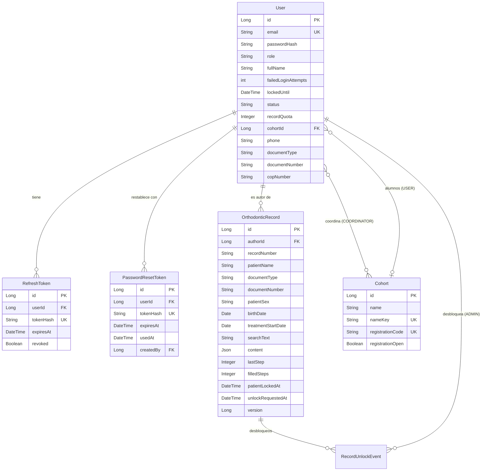

# Dominio de negocio — HS FACOP

Dimensión de **negocio** (sustituible por proyecto). Base de conocimiento del dominio: actores, glosario y modelo conceptual. Documento **vivo**: crece y se detalla a medida que cada capacidad se especifica y construye.

- Complementa `docs/vision.md` (objetivos + roadmap), `docs/architecture.md` (capas) y `docs/backend.md` (JPA/persistencia).
- Aquí va el **modelo conceptual** (entidades, relaciones, reglas de negocio de alto nivel). El **esquema físico** lo define Flyway (`modules/backend/.../db/migration`), no este documento.

> 📝 **Plantilla.** Las secciones marcadas con ✏️ son para rellenar en cada proyecto derivado. Lo marcado como *(construida)* describe lo que la plantilla ya trae.

---

## Actores del negocio ✏️

| Actor | Descripción | Rol de sistema (aprox.) |
|---|---|---|
| **Administrador** | Gestiona la aplicación: usuarios, configuración y métricas del panel. | `ADMIN` |
| **Usuario** | Usa las funcionalidades del producto dentro de su rol. | `USER` |
| **Tratante** | Alumno u odontólogo del posgrado (AEO/FACOP) que llena y corrige sus historias clínicas de ortodoncia. Solo ve las suyas. | `USER` |
| **Supervisor** | Docente que revisa y corrige las historias de todos los tratantes. | `ADMIN` |
| **Coordinación** | Docente que supervisa en solo lectura el avance y las historias de los alumnos de sus turmas (capacidad `cohorts`). No crea, edita ni imprime historias. | `COORDINATOR` |

> Los roles de sistema (`ADMIN`/`USER`/`COORDINATOR`) los define `authentication` (`COORDINATOR` desde `add-cohorts-coordinator`); el mapeo fino de permisos se detalla al construir cada capacidad. En pantalla: "Administrador", "Alumno" y "Coordinación".

## Glosario de términos clave ✏️

| Término | Significado |
|---|---|
| Historia clínica de ortodoncia | Registro de un paciente según el formato de la clínica (PDF de 14 págs.): anamnesis, análisis facial, funcional, oclusal, de modelos y radiográfico, diagnóstico, planes y firmas. Se identifica con un número correlativo por tratante (`AEO-001`). |
| Anamnesis | Entrevista inicial: queja principal, antecedentes médicos, hábitos, estructura familiar. Un texto sin respuesta se imprime "No refiere". |
| Guía de análisis facial | Documento de la clínica con las opciones e ilustraciones de cada pregunta del análisis facial y sus valores normativos. |
| AFAI | Altura facial anteroinferior; en los patrones II y III se marca aumentada o disminuida (excluyentes). |
| Overjet | Resalte horizontal de los incisivos superiores, en milímetros. |
| Mordida cruzada / Brodie | Alteraciones transversales de la oclusión (posterior uni o bilateral; Brodie = mordida en tijera). |
| Curva de Spee | Curvatura del plano oclusal inferior; normal o alterada (con descripción). |
| Clase de Angle | Relación canina o molar por lado: Clase I, II o III, con detalle en fracción ("½ cúspide"). |
| MI / MIH / RC | Máxima intercuspidación, mordida habitual y relación céntrica; si MI o MIH difieren de RC, se registra la relación canina en RC. |
| Notación FDI | Numeración de piezas dentales: permanentes 11–48 y temporales 51–85. |
| Análisis transversal de los modelos | Anchos de arcada medidos en los modelos (mm): intercanino (AIS/AII) e intermolar (AMS/AMI) superior e inferior, borde WALA, X Pc, X´ Pc y X ideal (escrito a mano), y distancias WALA–EV por diente inferior. |
| Promedio intermolar | Referencia por sexo para AMS (54,0 mm hombres / 52,4 mm mujeres) y AMI (47,2 / 46,1 mm); se muestra la diferencia con la medida. |
| WALA–EV | Distancia del borde WALA (unión mucogingival) al eje vestibular (EV) de cada diente inferior; normas: canino 0,6, 1er premolar 0,8, 2do premolar 1,3, 1er molar 2,0, 2do molar 2,2 mm. |
| Análisis de Moyers | Predicción del espacio requerido para canino y premolares a partir de la suma de los incisivos inferiores (42, 41, 31, 32), con la tabla de Moyers al 75 % (suma redondeada al 0,5 mm; tabla de 19,5 a 29,0 mm). Diferencia = espacio disponible − requerido, por arcada y lado. |
| Análisis de Nance (Nance & Carey) | Discrepancia óseo dentaria por arcada: SA (espacio disponible o longitud de arco, medido) − ST (espacio requerido: suma de los anchos mesiodistales de 15→25 o 45→35, de mesial a mesial del 1er molar). Negativa = falta espacio. |
| Análisis de Bolton | Discrepancia de tamaño dentario entre arcadas (comparte con Nance solo caninos y premolares; incisivos y 1eros molares son propios): relación total (12 piezas, 1er molar a 1er molar; media 91,3 %, rango 87,5–94,8) y relación anterior (6 piezas; media 77,2 %, rango 74,5–80,4) = suma mandibular ÷ suma maxilar × 100. Sobre la media hay exceso mandibular; bajo la media, exceso maxilar (real, ideal y diferencia de esa arcada). |
| Predisposición de apiñamiento | Tabla 2 de la ficha de Moyers: el odontólogo anota qué arcada/lado resulta positivo (sobra espacio), nulo o negativo (falta espacio). |
| Apoderado | Quien firma por un paciente menor de 18 años. |
| Cupo de historias | Máximo de historias clínicas que un tratante (`USER`) puede crear; toda cuenta nueva nace con el cupo inicial (1 por defecto) y el `ADMIN` lo ajusta por cuenta. Sin cupo = sin límite. Al llegar al tope no crea más, pero edita e imprime las suyas. |
| Historia completa | Historia con datos en los 7 pasos clínicos (1–7); Firmas (paso 8) no cuenta. Una historia anterior a las métricas, aún no vuelta a guardar, figura "sin calcular". |
| Datos fijos del paciente | Nombre, documento, fecha y lugar de nacimiento y sexo: quedan fijos al imprimir la historia por primera vez; solo el ADMIN los desbloquea (a pedido del tratante). |
| Avance impreso | Impresión de una ficha incompleta: lleva la marca "AVANCE · N de 7". |
| Turma | Grupo de alumnos de la institución (Turma 1, Turma 2…). Un alumno está en una turma o en ninguna; una coordinación supervisa una o más. Hoy hay una sola institución (no se modela). |
| Código de turma | Código de inscripción de 8 caracteres (`K7QM-4TXR`, sin 0/O/1/I) que el ADMIN comparte; quien se registra con él queda en esa turma. Opcional: sin código, alumno individual. |
| COP | Número de colegiatura del Colegio Odontológico del Perú (1 a 6 dígitos), opcional en la cuenta. |

---

## Fuente de verdad (local-first)

| Tipo de información | Vive en |
|---|---|
| Modelo de dominio (este doc) | `docs/domain.md` (local) |
| Comportamiento / casos de uso | `openspec/specs/<cap>/spec.md` (Scenarios) |
| Framing de user story ("como X quiero Y") | `proposal.md` del change |
| Backlog / tickets | *(opcional)* — hoy: local. Futuro híbrido: Jira |

> **Nota para el futuro híbrido (Jira).** Si más adelante se adopta Jira: sigue siendo **la capa de backlog**, nunca la fuente de verdad del dominio ni de lo construido. Regla: una sola fuente por tipo de info; el change referencia `JIRA-<id>` de forma cruzada. El dominio y las specs permanecen locales.

---

## Convenciones

- **Nivel de detalle**: aquí se listan entidades y campos **conceptuales** clave. Los tipos exactos, longitudes y validaciones finas se fijan en el `spec.md`/`design.md` de cada capacidad y en la migración Flyway correspondiente.
- Toda entidad tiene `id` (PK) y campos de auditoría (`createdAt`, `updatedAt`) salvo que se indique.
- Identificadores en inglés (convención de código); ver `docs/backend.md`.

---

## Entidades por capacidad

### `authentication` → **User** *(construida)*
Cuenta de acceso al sistema.
- `email` (único), `passwordHash` (BCrypt), `role` (`ADMIN` | `USER` | `COORDINATOR`, con `CHECK` en la base desde V18), `fullName`, `createdAt`/`updatedAt`.
- Bloqueo temporal por intentos fallidos (`add-login-lockout`): `failedLoginAttempts` (fallos consecutivos, se resetea con un login correcto o al fallar tras expirar el bloqueo) y `lockedUntil` (fin del bloqueo automático; nulo = sin bloqueo). Solo los modifican `UPDATE` atómicos; la entidad los lee pero no los escribe.
- Estado administrativo (`users`, `add-user-account-status`): `status` (`ACTIVE` | `DISABLED`), **independiente** de `lockedUntil` (si compartieran campo, expirar el bloqueo automático reactivaría una cuenta deshabilitada a mano). Las cuentas nuevas nacen `ACTIVE`; solo un `ADMIN` cambia el estado, y solo de cuentas `USER` o `COORDINATOR` (una coordinación deshabilitada conserva sus turmas); una cuenta `DISABLED` no inicia ni renueva sesión.
- Cupo de historias (`users` + `orthodontic-records`, `add-record-quota`): `recordQuota` (entero 0–9999 o nulo = sin límite). Las cuentas nuevas nacen con el cupo inicial del despliegue (`app.records.default-quota` / `RECORDS_DEFAULT_QUOTA`, 1 por defecto; vacío = sin límite; `update-default-record-quota`); las cuentas anteriores conservan el suyo. Solo aplica a cuentas `USER` y solo lo cambia un `ADMIN` (a una cuenta `ADMIN` responde 409); el `ADMIN` nunca se limita. El uso es la cantidad de historias con ese `author` (no se guarda). Se controla al crear, bajo el mismo bloqueo de la fila del autor que el correlativo (dos creaciones simultáneas no pasan el tope); cupo lleno → 409 `record-quota-reached` ("1 historia clínica" en singular). La numeración `AEO-NNN` es independiente por tratante. Un cupo por debajo de lo creado se permite y no toca las existentes; editar no consulta el cupo.
- Turma del alumno (`cohorts`, `add-cohorts-coordinator`): `cohort` (FK `Cohort`, nula = sin turma). Solo cuentas `USER` (`CHECK ck_users_cohort_only_user`); la asigna el `ADMIN` y no toca historias ni cupo.
- Turmas de coordinación: `coordinatorCohorts` (tabla `coordinator_cohorts`, una o más). Solo un `USER` **sin historias** pasa a `COORDINATOR` (pierde su turma y su cupo); volver a `USER` borra sus turmas y le da el cupo inicial. El rol nuevo llega al token en la siguiente renovación (≤ 15 min); las turmas se leen de la base en cada petición, y crear historias exige en la base el rol `USER` o `ADMIN`, así el token anterior no sirve para crear.
- Datos de contacto e identificación (`users`, `add-cohort-registration-code`), todos opcionales: `phone` (celular, 9 dígitos que empiezan con 9), `documentType` + `documentNumber` (mismo `DocumentType` y reglas que el paciente, siempre juntos) y `copNumber` (1–6 dígitos), con `CHECK` en V19; vacío = nulo. Se piden en el registro y la propia cuenta los corrige en "Mis datos" (`/api/me/profile`, la cuenta sale del token); el ADMIN los ve en "Usuarios" ("Ver datos", solo lectura); la coordinación no. Sin unicidad (dos cuentas de una persona = soporte).
- Contraseña (`authentication`, `add-password-change-reset`): la cuenta la cambia en "Mis datos" con la actual (incorrecta → 400 y suma al bloqueo por intentos; bloqueada → 400 sin comparar; la nueva ≥ 8 y distinta). Cambiarla revoca todas las sesiones renovables, quita el contador y emite una sesión nueva para ese dispositivo. Si la olvida, el ADMIN genera un enlace de restablecimiento (ver `PasswordResetToken`); sin envío por correo hasta la venta institucional.
- Candidatos para cambios posteriores de `users` (perfil, alta por admin): `username`.

### `authentication` + `users` → **PasswordResetToken** *(construida)*
Enlace de restablecimiento de contraseña (`add-password-change-reset`).
- `user` (FK), `tokenHash` (SHA-256 del token, único; el valor en claro solo se entrega al ADMIN al generarlo), `expiresAt` (24 h), `usedAt` (nulo = sin usar), `createdBy` (ADMIN), `createdAt`.
- Solo para cuentas `USER`/`COORDINATOR` activas (si no, 409). Generar uno nuevo borra los no usados de la cuenta. El enlace es `/restablecer#t=<token>` (en el fragmento: no llega al servidor ni a los logs). Usarlo fija la contraseña, lo marca usado, revoca las sesiones renovables y quita el bloqueo temporal; usado, vencido, anulado o de una cuenta deshabilitada → el mismo 400.

### `authentication` → **RefreshToken** *(construida)*
Token de refresco persistido para rotación y revocación real (logout). Se guarda el **hash** del token, nunca el valor en claro.
- `user` (FK), `tokenHash` (único), `expiresAt`, `revoked`, `createdAt`. El access token es JWT stateless (no se persiste).

### `orthodontic-records` → **OrthodonticRecord** *(construida, fases 1 y 2)*
Historia clínica de ortodoncia de un paciente. Columnas para lo que se lista o busca; el contenido clínico va en JSON (JSONB) tipado por paso.
- `author` (FK `User`, nunca cambia) y `recordNumber`: número que **asignan los docentes** (`update-orthodontic-records-anamnesis-fields`), con formato `AEO-` + 4 dígitos (`AEO-0001`–`AEO-9999`; hasta el 2026-10 era `AOC-`, convertido por V16 con los mismos dígitos), obligatorio al crear. Es **único entre todas las historias vigentes**, de cualquier autor y cohorte (los docentes no reinician la numeración; índice `ux_orthodontic_records_record_number`). Lo corrigen el autor o un `ADMIN` desde el paso 1, también tras imprimir (no forma parte de los datos fijos del paciente); al corregirlo, el número anterior queda libre. Otra historia con el mismo número → `409 record-number-taken`. Las historias de prueba anteriores recibieron números provisionales `AOC-` + id. (Antes era un correlativo por autor `AEO-001` con `recordSeq`, eliminado.)
- Paciente embebido (sin registro maestro de pacientes): `patientName` (obligatorio), `documentType` (`DNI` 8 dígitos | `FOREIGNER_CARD` 9 | `PASSPORT` 6–12, solo dígitos) + `documentNumber`, `patientSex` (`FEMALE` | `MALE`), `birthDate`, `birthPlace`, `address`, `phone`, `treatmentStartDate`, `treatingDentist` (por defecto el autor).
- Edad **calculada** (años cumplidos a la fecha de inicio de tratamiento o a hoy); menor de 18 → firma el apoderado.
- `content` (JSON, `schemaVersion` 10): anamnesis (higiene oral `EXCELLENT`/`GOOD`/`REGULAR`/`DEFICIENT`; primera menstruación Sí/No y la edad a la que ocurrió `menarcheAge` —8 a 18 años, no mayor que la edad actual, solo con sexo femenino y respuesta Sí; V17 convirtió el año guardado en edad con el año de nacimiento—), análisis facial (sellado labial con la separación interlabial `lipSealMm`, 0–20 mm, solo con Presenta), funcional, oclusal y extra, análisis de modelos (`models.transversal`, `models.moyers`, `models.nance` y `models.bolton` —guarda sus incisivos y 1eros molares; caninos y premolares son los de Nance—: anchos de pieza en 4,0–13,0 mm y demás medidas en 0–99,9 mm, con un decimal, fechas de análisis no futuras, predisposición de apiñamiento y conclusiones escritas, interpretaciones; las diferencias con promedios y normas, la suma de incisivos, el requerido de Moyers, el ST y la discrepancia de Nance y las relaciones de Bolton se calculan, no se guardan), radiográfico (diagnóstico cefalométrico: Steiner, Ricketts, McNamara, Wits, Tweed y Jarabak; se piden al menos 3, sin exigirlo en el borrador), diagnóstico y planes, firmas. Los campos condicionados se descartan al guardar si su condición no se cumple.
- `searchText` (paciente + documento + número, sin tildes ni mayúsculas) para la búsqueda; `version` para detectar ediciones concurrentes (409).
- `lastStep` (1–8 o nulo = paso 1): último paso del formulario en que se guardaron cambios (`update-orthodontic-records-autosave`); la historia se abre ahí desde el listado, en cualquier dispositivo. Recorrer pasos sin cambios no lo modifica. Las historias existentes se autoguardan (no las nuevas, que se crean con "Crear historia").
- `filledSteps` (máscara de bits, bit n-1 = paso n; nula = "sin calcular", historias guardadas antes de `add-dashboard-metrics`): pasos con algún dato según el último guardado, informados por el formulario (mismo criterio que la navegación de pasos); el servidor marca siempre el paso 1. Una historia está **completa** con los 7 pasos clínicos (1–7) con datos: Firmas no cuenta porque se completa a mano. Alimenta las métricas de Inicio (`dashboard`).
- Datos del paciente fijos (`add-patient-identity-lock`): `patientLockedAt` = primera impresión registrada (`POST /print`, esté completa o no). Desde entonces nombre, tipo y número de documento, fecha y lugar de nacimiento y sexo no cambian; se comparan en forma canónica (NFKC, sin tildes, mayúsculas ni espacios sobrantes; documento por dígitos), así corregir la escritura se permite. Domicilio, teléfono, fecha de inicio y contenido clínico siguen editables. Imprimir y guardar se serializan con bloqueo de fila; estas columnas no cuentan para `version`. Evita reusar una historia (con el cupo) para otro paciente.
- Desbloqueo: el autor pide `unlockRequest` (fecha + motivo ≤ 200, una pendiente a la vez); el `ADMIN` desbloquea (vuelve a fijarse en la próxima impresión) o descarta. Cada acción del ADMIN queda en `RecordUnlockEvent` (historia, ADMIN, acción `UNLOCKED`/`DISCARDED`, motivo, fecha), solo inserción.
- Impresión: las hojas solo salen desde el botón "Imprimir" (registra primero); las fichas incompletas llevan la marca "AVANCE · N de 7 pasos clínicos con datos · impreso el <fecha>" con fecha y conteo del servidor.
- "Hoy" (fechas no futuras, "impreso el", meses del panel) usa el reloj de la app en la zona de la clínica (`app.time-zone`, por defecto America/Lima), no la del servidor.
- Reglas: un `USER` solo alcanza sus historias (una ajena responde 404); un `ADMIN` alcanza todas y al guardar conserva el autor; un `COORDINATOR` solo **lee** las de los alumnos de sus turmas (fuera de ellas o sin turma, 404) y toda escritura (crear, guardar, imprimir, pedir o descartar desbloqueo, desbloquear) le responde 403. No se borran.
- Notas de evolución: no se registran en el sistema; se imprime la hoja en blanco (pág. 14 del PDF) y se llena a mano (decisión del usuario).

### `cohorts` → **Cohort** *(construida)*
Turma de alumnos (`add-cohorts-coordinator`).
- `name` (1–80, sin espacios sobrantes) y `nameKey` (nombre en minúsculas con espacios colapsados, único: `ux_cohorts_name_key`; repetido → 409 `cohort-name-taken`), `createdAt`. La crea y renombra el `ADMIN`; no se borra.
- Inscripción (`add-cohort-registration-code`): `registrationCode` (8 caracteres del alfabeto sin 0/O/1/I, único, generado con `SecureRandom`; V19 dio uno a cada turma existente) y `registrationOpen` (nace abierta). El ADMIN genera un código nuevo (el anterior deja de servir) y abre o cierra la inscripción. Registro con código: sin distinguir mayúsculas, espacios ni guiones; inexistente → 400 `invalid-cohort-code`, turma cerrada → 400 `cohort-registration-closed`, sin crear la cuenta. Cerrada no toca alumnos, coordinación ni la asignación manual. La coordinación no ve el código.
- Inicio de la coordinación: por turma, alumnos, historias (completas, en progreso, sin calcular), alumnos sin historias y el detalle por alumno.

---

## Diagrama ER (conceptual)

> Se amplía con cada capacidad de negocio.

---

## Cómo se actualiza este documento

1. Al proponer una capacidad (`/opsx:propose`), su `design.md` detalla las entidades/campos nuevos.
2. Al implementarla, la migración Flyway crea el esquema real.
3. Al archivar el change, se **consolida** aquí la parte del dominio afectada (entidades, campos, relaciones y reglas ya construidas), manteniendo el ER al día.
